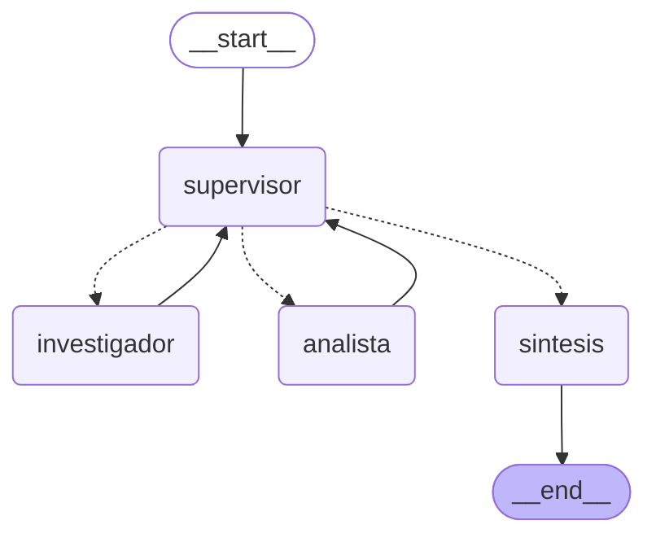
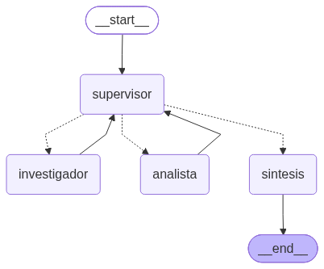

# Orquestador multi-agente especializado (Supervisor + especialistas)

Pre-entrega 6 de **AI Engineering (Coderhouse)**. Prototipo de un orquestador multi-agente de análisis e investigación construido con **LangGraph**. Un **Supervisor** recibe la consulta del usuario, delega en dos especialistas con herramientas acotadas, valida lo que devuelven con una rúbrica y, cuando la respuesta es suficiente, pasa a una fase de **síntesis** final.

| Rol | Nodo | Herramientas | Qué NO puede hacer |
|---|---|---|---|
| Supervisor | `supervisor` | ninguna (salida estructurada con Pydantic) | responder al usuario |
| Investigador | `investigador` | `buscar_documentacion_fastapi`: RAG híbrido sobre el **Vector DB de la Pre-entrega 4** (BM25 + Pinecone) | calcular |
| Analista | `analista` | `calculadora` (segura, con `ast`), `resumen_estadistico` | buscar información |
| Síntesis | `sintesis` | ninguna | agregar datos propios |

- **LLM:** Gemini (`langchain-google-genai`) en todos los nodos.
- **Especialistas:** `create_agent` de LangChain 1.x (es el reemplazo de `create_react_agent` de LangGraph, que quedó deprecado).
- **Fuente externa:** el índice `fastapi-docs-rag` de Pinecone, que se cargó en la PE4 con documentación de FastAPI en castellano. Si no hay `PINECONE_API_KEY`, el Investigador hace una búsqueda simulada: BM25 local sobre el mismo corpus (`data/`).

---

## Diagrama del grafo

Generado con `app.get_graph().draw_mermaid()` / `draw_mermaid_png()` (`python main.py --grafo`):





Las aristas punteadas son las **conditional edges** del Supervisor. La función de ruteo devuelve un `Literal["investigador", "analista", "sintesis"]` que coincide con los nombres de los nodos (`graph.py`).

---

## Estructura del repositorio

```
├── state.py                  # AgentState (hereda de MessagesState) + Contribucion + Decision
├── agents/
│   ├── research_agent.py     # Investigador: tool de búsqueda + create_agent + nodo
│   ├── analyst_agent.py      # Analista: calculadora segura + estadística + create_agent + nodo
│   ├── supervisor.py         # Supervisor: rúbrica de validación, decisión estructurada y guardas
│   ├── synthesizer.py        # Síntesis de la respuesta final
│   └── common.py             # invocación de especialistas con contexto acotado
├── graph.py                  # StateGraph: nodos, conditional edges y compilación
├── main.py                   # CLI: corre una consulta mostrando el flujo de delegación
├── knowledge_base.py         # RAG híbrido BM25 + Pinecone (Vector DB de la PE4)
├── config.py                 # modelo, límites del orquestador, conexión a Pinecone
├── demo.ipynb                # demo ejecutada del flujo de delegación
├── data/                     # corpus de la PE4 (para BM25 y el modo sin Pinecone)
├── docs/grafo.mmd, grafo.png # diagrama exportado
└── tests/                    # pytest sin red ni API keys (con dobles de prueba)
```

---

## Cómo ejecutarlo

Requisitos: Python 3.12 o superior (probado con 3.14.7) y una API key de Gemini, que es gratis en <https://aistudio.google.com/apikey>. La key de Pinecone es opcional.

```bash
python -m venv .venv
.venv\Scripts\Activate.ps1          # Windows (PowerShell)
source .venv/bin/activate           # Linux / macOS
pip install -r requirements.txt
cp .env.example .env                # en Windows: copy .env.example .env
```

Completá `GOOGLE_API_KEY` (y opcionalmente `PINECONE_API_KEY`) en `.env`.

El modelo por defecto es `gemini-flash-lite-latest`; se puede cambiar con `GEMINI_MODEL`. Una consulta completa hace unas 8–12 llamadas al LLM (supervisor, especialistas con sus tool calls y síntesis). Con el free tier de Gemini, la cuota diaria por modelo se agota rápido: si aparece `429 RESOURCE_EXHAUSTED`, probá otro modelo o esperá a que se renueve la cuota. Un `503 UNAVAILABLE` ("high demand") es saturación del lado de Google, y la librería lo reintenta sola.

```bash
python main.py                                  # consulta de demo
python main.py "¿Qué código devuelve FastAPI si falla la validación?"
python main.py --grafo                          # regenera docs/grafo.mmd y docs/grafo.png
pytest -q                                       # tests (no necesitan API keys)
```

La demo también está en [`demo.ipynb`](demo.ipynb), ejecutada y con las salidas guardadas.

---

## Estado compartido (`state.py`)

```python
class AgentState(MessagesState):
    next_agent: Optional[Literal["investigador", "analista", "FINISH"]]
    instruccion: str                                            # orden del Supervisor al próximo especialista
    contribuciones: Annotated[list[Contribucion], operator.add] # quién aportó qué
    decisiones: Annotated[list[Decision], operator.add]         # bitácora del Supervisor
    pasos: int
    task_completed: bool
    motivo_cierre: str
```

- Cada `Contribucion` guarda `agente`, `paso`, la `instruccion` recibida, el `aporte` y las `herramientas` que el agente invocó de verdad (se leen de los `ToolMessage`). Así queda trazado qué agente aportó cada dato.
- Cada `Decision` guarda el destino elegido, la justificación y la rúbrica evaluada en ese turno.
- El reducer `operator.add` **acumula** las listas: un nodo devuelve solo su aporte nuevo y LangGraph lo suma a lo anterior, sin pisarlo. Así no se pierde contexto entre turnos.

---

## ¿Por qué una topología jerárquica (Supervisor)?

- **La tarea es secuencial y depende de los datos.** Primero hay que *conseguir* los datos y después *procesarlos*. Para eso alcanza con un único punto de control que decida el orden. Una red de agentes que se hablan entre sí (topología *network*) agregaría caminos posibles sin aportar nada.
- **Un único responsable del flujo.** Los especialistas nunca se comunican entre sí: siempre vuelven al Supervisor (`investigador -> supervisor`, `analista -> supervisor`). Eso hace que el flujo sea predecible, fácil de depurar y fácil de limitar.
- **Escalable.** Para sumar un especialista nuevo (por ejemplo, de análisis de sentimiento) se agrega un nodo, una opción al `Literal` y una línea en el prompt del Supervisor.
- **Validación centralizada.** El mismo nodo que enruta revisa la calidad antes de dar el `END`.

### Flujo de supervisión y validación

En cada turno el Supervisor devuelve una `DecisionSupervisor` (salida estructurada con Pydantic) que contiene:

1. Una **rúbrica** con cuatro criterios booleanos:
   - `datos_con_fuente`: están los datos de la documentación y cada uno cita su fuente.
   - `calculos_verificados`: el analista hizo con su herramienta todos los cálculos que pide la pregunta.
   - `consistencia`: los números del analista coinciden con los datos del investigador.
   - `responde_pregunta`: lo reunido alcanza para responder todas las partes de la pregunta.
2. El **próximo nodo**: `investigador`, `analista` o `FINISH`. Solo se usa `FINISH` cuando la rúbrica está aprobada.
3. Una **instrucción autocontenida** para el especialista elegido. Si un aporte quedó incompleto, el Supervisor puede devolvérselo **al mismo especialista** con un pedido de refinamiento que dice exactamente qué corregir.

### Cómo se evita el "Supervisor Infinito"

La decisión del LLM pasa por **guardas deterministas en código** (`aplicar_guardas` en `agents/supervisor.py`), que tienen la última palabra:

- `MAX_PASOS` (6 por defecto): tope total de delegaciones. Si se alcanza, ni siquiera se consulta al LLM: se va directo a la síntesis.
- `MAX_VISITAS_POR_AGENTE` (2 por defecto): cada especialista tiene un intento inicial y **un** refinamiento. Si el LLM pide un tercero, se fuerza el cierre.
- Cualquier valor inesperado de `next_agent` se enruta a `sintesis`.
- El `motivo_cierre` queda en el estado (por ejemplo, "rúbrica de validación aprobada" o "se alcanzó el límite…"), y la síntesis lo usa para avisar si la respuesta quedó incompleta.

### Cómo se evita la "Contaminación de Contexto"

- **Especialistas:** no reciben `state["messages"]`. El Investigador recibe solo la instrucción del Supervisor. El Analista recibe la instrucción más los aportes del Investigador, que son los datos sobre los que tiene que calcular, y no ve la conversación, las decisiones ni la metadata del sistema.
- **Supervisor:** tampoco lee el historial de chat. Trabaja sobre el estado estructurado: la pregunta original y las `contribuciones`.

### Manejo de conflictos entre agentes

| Conflicto | Cómo se resuelve |
|---|---|
| Dos agentes querrían hacer lo mismo | No pueden: las herramientas son **disjuntas** (el Investigador no tiene calculadora y el Analista no tiene búsqueda). |
| El Analista usa un número distinto al que encontró el Investigador | El criterio `consistencia` de la rúbrica falla y el Supervisor devuelve la tarea con una instrucción de refinamiento. |
| Al Analista le falta un dato | Su prompt le pide declarar qué dato falta en lugar de inventarlo. Entonces el Supervisor vuelve a delegar en el Investigador. |
| El desacuerdo persiste | Las guardas cortan el ciclo. La síntesis responde **solo** con los aportes registrados y explicita la contradicción o el faltante en vez de elegir un dato inventado. |
| ¿Quién tiene la última palabra? | El Supervisor decide a quién delegar, pero las reglas en código pueden anular su decisión, y la fuente de verdad son los aportes con cita a la documentación. |

---

## Demo: consulta que obliga a usar ambos dominios

> Voy a desplegar mi API de FastAPI en un servidor de 8 núcleos con Gunicorn y workers de Uvicorn. La app carga un modelo de machine learning de 1 GB en memoria. Según la documentación, ¿cuántos workers conviene levantar para empezar y cuánta memoria consumirían en total? Si el servidor tiene 16 GB de RAM, ¿alcanza? Si no alcanza, ¿cuál es la cantidad máxima de workers que entra dejando 2 GB libres para el sistema?

Traza real (resumida) de [`demo.ipynb`](demo.ipynb), con `gemini-flash-lite-latest` y Pinecone en modo híbrido:

```
🧭 SUPERVISOR  rúbrica: datos_con_fuente=✘ calculos_verificados=✘ consistencia=✘ responde_pregunta=✘
               decisión: -> investigador
🔎 INVESTIGADOR herramientas: buscar_documentacion_fastapi
               "empezar con (2 x cantidad de núcleos) + 1 workers ... [despliegue_en_produccion.pdf, p. 1]"
🧭 SUPERVISOR  rúbrica: datos_con_fuente=✔ calculos_verificados=✘ ...   decisión: -> analista
🧮 ANALISTA    herramientas: calculadora, calculadora, calculadora
               (2 * 8) + 1 = 17 workers · 17 * 1 GB = 17 GB · floor((16 - 2) / 1) = 14 workers
🧭 SUPERVISOR  rúbrica: ✔ ✔ ✔ ✔   decisión: -> FINISH (rúbrica de validación aprobada)
📝 SINTESIS    "No alcanza con 16 GB ... el máximo es 14 workers [despliegue_en_produccion.pdf, p. 1]"

🗺️ Recorrido: supervisor -> investigador -> supervisor -> analista -> supervisor -> sintesis
```

El notebook muestra además:

- **Ruteo dinámico:** ante una pregunta que no necesita cálculos ("¿qué código devuelve FastAPI si falla la validación?"), el Supervisor cierra sin pasar por el Analista: `supervisor -> investigador -> supervisor -> sintesis`.
- **Guardas anti-bucle:** un Supervisor simulado que pide refinar al Investigador para siempre queda cortado al tercer turno con el motivo *"'investigador' ya agotó sus 2 intentos"*.
