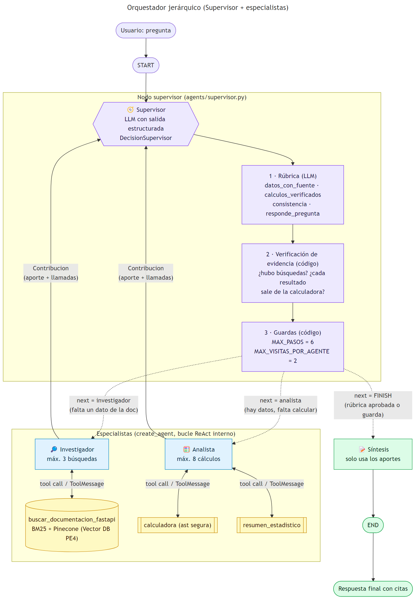
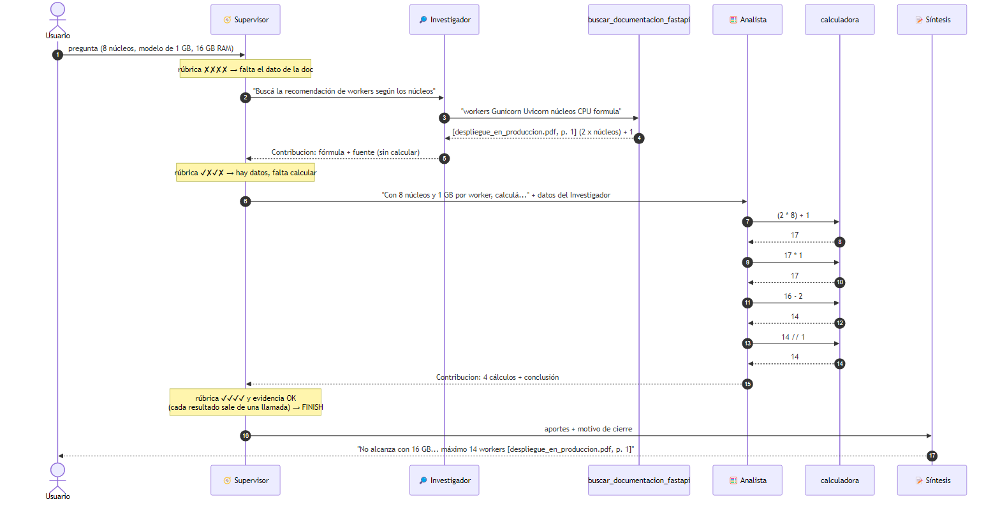

# Orquestador multi-agente especializado (Supervisor + especialistas)

Pre-entrega 6 de **AI Engineering (Coderhouse)**. Prototipo de un orquestador multi-agente de análisis e investigación construido con **LangGraph**. Un **Supervisor** recibe la consulta del usuario, delega en dos especialistas con herramientas acotadas, valida lo que devuelven (con una rúbrica y contrastándola con las llamadas a herramientas que realmente se ejecutaron) y, cuando la respuesta es suficiente, pasa a una fase de **síntesis** final.

| Rol | Nodo | Herramientas | Qué NO puede hacer |
|---|---|---|---|
| Supervisor | `supervisor` | ninguna (salida estructurada con Pydantic) | responder al usuario |
| Investigador | `investigador` | `buscar_documentacion_fastapi`: RAG híbrido sobre el **Vector DB de la Pre-entrega 4** (BM25 + Pinecone) | calcular |
| Analista | `analista` | `calculadora` (segura, con `ast`), `resumen_estadistico` | buscar información |
| Síntesis | `sintesis` | ninguna | agregar datos propios |

- **LLM:** Gemini (`langchain-google-genai`) en todos los nodos.
- **Especialistas:** `create_agent` de LangChain 1.x (es el reemplazo de `create_react_agent` de LangGraph, que quedó deprecado), con `ToolCallLimitMiddleware` para acotar cuántas veces puede usar sus herramientas.
- **Fuente externa:** el índice `fastapi-docs-rag` de Pinecone, que se cargó en la PE4 con documentación de FastAPI en castellano. Si no hay `PINECONE_API_KEY`, el Investigador hace una búsqueda simulada: BM25 local sobre el mismo corpus (`data/`).

### Dónde se cubre cada criterio de evaluación

| Criterio | Sección del README | Código | Evidencia ejecutable |
|---|---|---|---|
| **Documentación y Visualización** | [1. Topología del grafo](#1-topología-del-grafo) y [5. Diagramas adicionales](#5-diagramas-adicionales) | `docs/arquitectura.mmd/.png`, `docs/grafo.mmd/.png`, `docs/secuencia_demo.mmd/.png` | `python main.py --grafo` regenera el diagrama a partir del grafo compilado |
| **Arquitectura y Flujo del Grafo (Supervisor)** | [2. El Supervisor: delegación dinámica](#2-el-supervisor-delegación-dinámica) | `graph.py`, `agents/supervisor.py`, `state.py` | tests `test_flujo_completo_*`, `test_evidencia_*`, `test_refinamiento_*`, `test_corte_*`; [ejecuciones reales](#6-demo-ejecuciones-reales) |
| **Especialización de Agentes y Herramientas** | [3. Especialización de agentes y herramientas](#3-especialización-de-agentes-y-herramientas) | `agents/research_agent.py`, `agents/analyst_agent.py`, `agents/common.py` | tests `test_herramientas_disjuntas_*`, `test_agente_analista_real_*`, `test_investigador_real_*`, `test_busqueda_*`, `test_calculadora_*` |

---

## 1. Topología del grafo

### 1.1 Topología elegida: jerárquica (Supervisor)

El orquestador usa una topología **jerárquica de un nivel**: un nodo central (el Supervisor) que es el **único** que decide a dónde va el flujo, y especialistas que son "hojas": reciben una tarea, la resuelven con sus herramientas y devuelven el control.



<sub>Fuente editable: [`docs/arquitectura.mmd`](docs/arquitectura.mmd). Violeta = control, celeste = especialistas, amarillo = herramientas, verde = cierre. Líneas punteadas = aristas condicionales; continuas = aristas fijas.</sub>

### 1.2 Nodos: qué lee y qué escribe cada uno en el estado

Todos los nodos comparten un único estado (`AgentState`, ver [1.5](#15-estado-compartido-statepy)). Cada nodo lee solo lo que necesita y devuelve solo lo que cambia:

| Nodo | Responsabilidad | Lee del estado | Escribe en el estado |
|---|---|---|---|
| `supervisor` | Evaluar lo reunido, decidir el próximo paso y redactar la orden | pregunta original, `contribuciones`, `pasos` | `next_agent`, `instruccion`, `decisiones` (+1), `task_completed`, `motivo_cierre` |
| `investigador` | Buscar datos en la documentación y citarlos | **solo** `instruccion` | `contribuciones` (+1), `pasos` (+1), `messages` (+1) |
| `analista` | Calcular con los datos reunidos | `instruccion` + aportes del Investigador | `contribuciones` (+1), `pasos` (+1), `messages` (+1) |
| `sintesis` | Redactar la respuesta final con citas | pregunta, `contribuciones`, `motivo_cierre` | `messages` (+1), `task_completed` |

### 1.3 Aristas

| Arista | Tipo | Condición |
|---|---|---|
| `START → supervisor` | fija | Toda consulta entra por el Supervisor. |
| `supervisor → investigador` | **condicional** | `next_agent == "investigador"`: falta un dato de la documentación (o hay que refinarlo). |
| `supervisor → analista` | **condicional** | `next_agent == "analista"`: están los datos y falta calcular (o recalcular). |
| `supervisor → sintesis` | **condicional** | `next_agent == "FINISH"` o cualquier valor inesperado: rúbrica aprobada, o una guarda forzó el cierre. |
| `investigador → supervisor` | fija | El especialista **siempre** devuelve el control. |
| `analista → supervisor` | fija | Ídem. |
| `sintesis → END` | fija | Única salida del grafo. |

No existe ninguna arista `investigador ↔ analista`: los especialistas no se comunican entre sí. Lo único que comparten es el estado, y el que decide quién lee qué es el Supervisor.

### 1.4 Propiedades de la topología

- **Un ciclo, un solo punto de decisión.** El único ciclo del grafo es `supervisor → especialista → supervisor`. Cualquier recorrido tiene la forma `supervisor (→ especialista → supervisor)* → sintesis → END`.
- **Terminación garantizada.** Cada vuelta del ciclo suma 1 a `pasos`. Con `MAX_PASOS = 6`, el Supervisor fuerza `FINISH` sin consultar al LLM, así que el peor caso es de 6 delegaciones (14 ejecuciones de nodos). Además, `MAX_VISITAS_POR_AGENTE = 2` corta antes si el Supervisor insiste con el mismo especialista.
- **Recorrido dinámico.** El camino depende de la pregunta: con datos y cálculos pasa por los dos especialistas; si solo hacen falta datos, salta al Analista ([sección 6](#6-demo-ejecuciones-reales)).
- **Escalable.** Para sumar un especialista nuevo (por ejemplo, de análisis de sentimiento) se agrega un nodo, una opción al `Literal` de `next_agent`, una entrada al mapa de `add_conditional_edges` y una línea en el prompt del Supervisor. El resto del grafo no cambia.

### 1.5 Estado compartido (`state.py`)

```python
class AgentState(MessagesState):
    next_agent: Optional[Literal["investigador", "analista", "FINISH"]]  # despacho del Supervisor
    instruccion: str                                            # orden al próximo especialista
    contribuciones: Annotated[list[Contribucion], operator.add] # quién aportó qué (y con qué tool)
    decisiones: Annotated[list[Decision], operator.add]         # bitácora del Supervisor
    pasos: int
    task_completed: bool
    motivo_cierre: str
```

- Cada `Contribucion` guarda `agente`, `paso`, la `instruccion` recibida, el `aporte`, las `herramientas` usadas y las `llamadas`: cada tool call con sus **argumentos**, su **resultado** y si tuvo **éxito**. Esto se lee de los `AIMessage.tool_calls` y los `ToolMessage` del agente.
- Cada `Decision` guarda el destino elegido, la justificación y la rúbrica evaluada en ese turno.
- El reducer `operator.add` **acumula** las listas: un nodo devuelve solo su aporte nuevo y LangGraph lo suma a lo anterior, sin pisarlo. Así no se pierde contexto entre turnos.

### 1.6 Por qué jerárquica y no otra topología

| Alternativa | Por qué no |
|---|---|
| Cadena fija `investigador → analista → síntesis` | No se adapta: siempre pasaría por el Analista aunque la pregunta no requiera cálculos, y no permite devolver un aporte malo para refinarlo. |
| Red (*network*) de agentes que se pasan el control | Agrega caminos posibles (investigador ↔ analista) sin aportar nada: cuesta más depurar y limitar, y no hay un único responsable de cortar el ciclo. |
| **Jerárquica (Supervisor)** ✔ | La tarea es secuencial y depende de los datos (primero *conseguirlos*, después *procesarlos*). Un único punto de control decide el orden, valida antes de cerrar y garantiza la parada. |

---

## 2. El Supervisor: delegación dinámica

### 2.1 Construcción del `StateGraph` (`graph.py`)

```python
grafo = StateGraph(AgentState)
grafo.add_node("supervisor", crear_nodo_supervisor(decisor))
grafo.add_node("investigador", crear_nodo_investigador(investigador))
grafo.add_node("analista", crear_nodo_analista(analista))
grafo.add_node("sintesis", crear_nodo_sintesis(llm_sintesis))

grafo.add_edge(START, "supervisor")                         # entrada única
grafo.add_conditional_edges("supervisor", enrutar, {        # delegación dinámica
    "investigador": "investigador",
    "analista": "analista",
    "sintesis": "sintesis",
})
grafo.add_edge("investigador", "supervisor")                # retorno obligatorio
grafo.add_edge("analista", "supervisor")
grafo.add_edge("sintesis", END)
app = grafo.compile()


def enrutar(state: AgentState) -> Literal["investigador", "analista", "sintesis"]:
    destino = state.get("next_agent")
    if destino in ("investigador", "analista"):
        return destino
    return "sintesis"  # FINISH (o cualquier valor inesperado) cierra el flujo
```

### 2.2 Qué hace el nodo Supervisor en cada turno

El Supervisor (`agents/supervisor.py`) no sigue un guion fijo. Cada turno pasa por **un LLM y dos capas de control en código**:

```
nodo_supervisor(state)
 ├─ 0. Guarda previa: si pasos >= MAX_PASOS → FINISH sin llamar al LLM
 ├─ 1. DECISIÓN (LLM con with_structured_output(DecisionSupervisor))
 │     entrada: pregunta original + contribuciones (aporte + tool calls reales)
 │              + delegaciones y visitas restantes
 │     salida:  rubrica (4 booleanos) · next · instruccion · razon
 ├─ 2. contrastar_con_evidencia(state, decision)     ← código
 │     si el LLM quiere cerrar pero las tool calls no lo respaldan,
 │     corrige la rúbrica y redirige al especialista que corresponde
 ├─ 3. aplicar_guardas(state, decision)              ← código
 │     límites de pasos y de visitas: pueden forzar FINISH
 └─ 4. Escribe next_agent, instruccion, decisiones[+1], motivo_cierre
        → enrutar() lee next_agent y LangGraph sigue la arista condicional
```

La salida estructurada garantiza que la decisión sea siempre un destino válido:

```python
class DecisionSupervisor(BaseModel):
    rubrica: RubricaValidacion     # datos_con_fuente, calculos_verificados, consistencia, responde_pregunta
    next: Literal["investigador", "analista", "FINISH"]
    instruccion: str               # orden autocontenida (o pedido de refinamiento)
    razon: str
```

### 2.3 Reglas de delegación

| Situación | Decisión | Instrucción que redacta |
|---|---|---|
| Falta un dato de la documentación | `investigador` | **Solo qué buscar** (la regla, la fórmula). No le pasa los números del usuario, para que no calcule. |
| Están los datos pero falta un cálculo | `analista` | Los números del usuario y qué calcular. Los datos del Investigador le llegan solos. |
| Un aporte está incompleto, sin fuente o es inconsistente | el **mismo** especialista | Pedido de refinamiento que dice exactamente qué corregir. |
| Los 4 criterios de la rúbrica se cumplen **y** la evidencia los respalda | `FINISH` → `sintesis` | (vacía) |

### 2.4 Validación: la rúbrica la evalúa el LLM, la evidencia la controla el código

Un LLM puede marcar "cálculos verificados" aunque no lo estén. Lo detecté en una ejecución real: el Investigador calculó `(2 × 8) + 1 = 17` por su cuenta, y el Supervisor aprobó la rúbrica igual. Por eso, antes de aceptar un `FINISH`, `contrastar_con_evidencia` revisa las tool calls registradas en el estado:

| Chequeo en código | Si falla |
|---|---|
| ¿Hay al menos una búsqueda **exitosa** del Investigador? | `datos_con_fuente = False` → redirige al `investigador` |
| Si el Analista participó, ¿usó su calculadora con éxito? | `calculos_verificados = False` → redirige al `analista` |
| Cada resultado `= N` que muestra el Analista, ¿sale de una llamada exitosa a la calculadora o de la pregunta? (`numeros_sin_respaldo`) | redirige al `analista` con la lista de resultados sin respaldo |

Las redirecciones pasan después por las guardas, así que nunca generan un bucle: si el especialista ya agotó sus visitas, se cierra igual y la síntesis lo aclara.

### 2.5 Cómo se evita el "Supervisor Infinito"

La decisión pasa por **guardas deterministas en código** (`aplicar_guardas`), que tienen la última palabra:

- `MAX_PASOS` (6 por defecto): tope total de delegaciones. Si se alcanza, ni siquiera se consulta al LLM: se va directo a la síntesis.
- `MAX_VISITAS_POR_AGENTE` (2 por defecto): cada especialista tiene un intento inicial y **un** refinamiento. Si se pide un tercero, se fuerza el cierre.
- Cualquier valor inesperado de `next_agent` se enruta a `sintesis`.
- El `motivo_cierre` queda en el estado, y la síntesis lo usa para avisar si la respuesta quedó incompleta.

### 2.6 Cómo se evita la "Contaminación de Contexto"

- **Especialistas:** no reciben `state["messages"]`. El Investigador recibe solo la instrucción del Supervisor. El Analista recibe la instrucción más los aportes del Investigador, y no ve la conversación, las decisiones ni la metadata del sistema (`test_flujo_completo_*` lo verifica).
- **Supervisor:** tampoco lee el historial de chat. Trabaja sobre el estado estructurado: la pregunta original y las `contribuciones`.

### 2.7 Manejo de conflictos entre agentes

| Conflicto | Cómo se resuelve |
|---|---|
| Dos agentes querrían hacer lo mismo | No pueden: las herramientas son **disjuntas**. |
| El Investigador hace una cuenta que no le corresponde | Su prompt se lo prohíbe y el Supervisor no le pasa los números del usuario. Si igual pasa, el número no cuenta como verificado y lo recalcula el Analista. |
| El Analista usa un número distinto al del Investigador | Falla `consistencia` y el Supervisor pide un refinamiento. |
| Al Analista le falta un dato | Su prompt le pide declarar qué falta en lugar de inventarlo, y el Supervisor vuelve a delegar en el Investigador. |
| Un especialista falla (cuota del LLM, error de red) | El fallo queda registrado como aporte y el grafo sigue: el Supervisor decide si reintentar o cerrar. |
| El desacuerdo persiste | Las guardas cortan el ciclo. La síntesis responde **solo** con los aportes registrados y explicita la contradicción o el faltante. |

---

## 3. Especialización de agentes y herramientas

### 3.1 Cómo interactúa un especialista con sus herramientas

Cada especialista es un agente ReAct creado con `create_agent`. Dentro de su nodo corre un **bucle interno**: el LLM pide una tool call, la herramienta **se ejecuta en Python**, el resultado vuelve como `ToolMessage`, y el LLM decide si llama otra o responde.

```
nodo especialista (agents/common.py::ejecutar_especialista)
 ├─ entrada acotada: instrucción del Supervisor (+ datos del Investigador, si es el Analista)
 ├─ agente.invoke(..., recursion_limit=25)
 │    ┌─> LLM decide: tool call ──> herramienta Python ──> ToolMessage ─┐
 │    └──────────────────────────────────────────────────────────────────┘
 │    ToolCallLimitMiddleware: a partir de la llamada N+1, la herramienta se bloquea
 │    y el agente tiene que responder con lo que ya tiene
 ├─ registra cada llamada: herramienta · argumentos · resultado · éxito
 └─ si el agente lanza una excepción: aporte fallido registrado, el grafo no se cae
```

| Mecanismo de robustez | Dónde | Para qué |
|---|---|---|
| `ToolCallLimitMiddleware(run_limit=3)` en el Investigador, `8` en el Analista | `research_agent.py`, `analyst_agent.py` | Hace cumplir **en código** el "máximo 3 búsquedas" del prompt. Lo prueba `test_investigador_real_no_supera_el_limite_de_busquedas`. |
| `recursion_limit` del subgrafo del agente | `common.py` | Red de seguridad del bucle ReAct interno. |
| Las herramientas devuelven `"Error ..."` en vez de lanzar | `calculadora`, `buscar_documentacion_fastapi` | El LLM ve el error y puede corregir la expresión o reformular la búsqueda. |
| `try/except` alrededor del agente | `common.py` | Un especialista que falla no tumba el grafo (`test_especialista_que_falla_no_tumba_el_grafo`). |
| Campo `exito` en cada llamada | `common.py` | Las llamadas bloqueadas o con error **no** cuentan como evidencia para el Supervisor. |

### 3.2 Investigador (`agents/research_agent.py`)

| | |
|---|---|
| **Tarea específica** | Encontrar datos concretos en la documentación de FastAPI y citarlos. |
| **Herramienta** | `buscar_documentacion_fastapi(consulta: str) -> str` |
| **Qué hace** | Consulta el índice `fastapi-docs-rag` de Pinecone (Vector DB de la PE4) con un retriever **híbrido** BM25 + embeddings de Gemini, fusionados con `EnsembleRetriever` (`knowledge_base.py`). Devuelve los fragmentos con su fuente `[archivo, p. N]`. Sin Pinecone, cae a BM25 local sobre el mismo corpus. Si la base falla, devuelve un error legible. |
| **Restricciones** | Buscar siempre antes de responder (máx. 3 búsquedas, impuesto por middleware). No calcular ni aplicar fórmulas a los datos del usuario. Citar la fuente de cada dato. |

Ejemplo real de una llamada que hizo el Investigador:

```
↳ buscar_documentacion_fastapi(consulta='workers Gunicorn Uvicorn núcleos CPU formula recomendacion')
  -> [despliegue_en_produccion.pdf, p. 1] 1. Servidores ASGI y workers ... la documentación de
     Gunicorn sugiere empezar con (2 x cantidad de núcleos) + 1 workers y ajustar con pruebas de carga ...
```

### 3.3 Analista (`agents/analyst_agent.py`)

| | |
|---|---|
| **Tarea específica** | Hacer los cálculos que pide la pregunta con los datos que reunió el Investigador. |
| **Herramientas** | `calculadora(expresion: str) -> str` y `resumen_estadistico(valores: list[float]) -> str` |
| **Qué hacen** | `calculadora` parsea la expresión con `ast` y solo permite aritmética (`+ - * / // % **`) y `round, min, max, abs, floor, ceil, sqrt`. **No usa `eval`**: un texto generado por un LLM nunca se ejecuta como código. `resumen_estadistico` calcula n, suma, promedio, mediana, mín., máx. y desvío. |
| **Restricciones** | Una llamada a la herramienta por **cada** resultado que muestre (el Supervisor lo verifica). No buscar ni inventar datos. Recalcular los números derivados que le lleguen. Declarar qué dato falta si no puede calcular. |

Salidas reales de las herramientas:

```
calculadora("(2 * 8) + 1")          -> (2 * 8) + 1 = 17
calculadora("floor((16 - 2) / 1)")  -> floor((16 - 2) / 1) = 14
calculadora("__import__('os')")     -> Error al calcular '__import__('os')': elemento no permitido ...
resumen_estadistico([17, 14, 9])    -> n=3, suma=40, promedio=13.3333, mediana=14, min=9, max=17, desvio=4.041
```

### 3.4 Por qué la especialización es real (y no solo de nombre)

1. **Herramientas disjuntas:** ningún especialista *puede* hacer el trabajo del otro (`test_herramientas_disjuntas_entre_especialistas`).
2. **Las herramientas se ejecutan de verdad:** `test_agente_analista_real_ejecuta_su_herramienta` arma el agente real con `create_agent` (solo reemplaza el LLM por uno guionado) y verifica que lo registrado sea la salida real de la calculadora.
3. **Cada resultado tiene trazabilidad:** el Supervisor ve las tool calls con argumentos y resultados, y el código rechaza resultados que no salen de una llamada (`test_numeros_sin_respaldo_*`, `test_evidencia_*`).

---

## 4. Estructura del repositorio

```
├── state.py                  # AgentState + Contribucion + LlamadaHerramienta + Decision
├── agents/
│   ├── research_agent.py     # Investigador: tool de búsqueda + create_agent (+ límite de llamadas) + nodo
│   ├── analyst_agent.py      # Analista: calculadora segura + estadística + create_agent (+ límite) + nodo
│   ├── supervisor.py         # Supervisor: rúbrica, verificación de evidencia y guardas
│   ├── synthesizer.py        # Síntesis de la respuesta final
│   └── common.py             # invocación de especialistas con contexto acotado + traza de tool calls
├── graph.py                  # StateGraph: nodos, conditional edges y compilación
├── main.py                   # CLI: corre una consulta mostrando el flujo de delegación
├── knowledge_base.py         # RAG híbrido BM25 + Pinecone (Vector DB de la PE4)
├── config.py                 # modelo, límites del orquestador y de herramientas, Pinecone
├── demo.ipynb                # demo ejecutada del flujo de delegación
├── data/                     # corpus de la PE4 (para BM25 y el modo sin Pinecone)
├── docs/
│   ├── arquitectura.mmd/.png   # topología con condiciones, herramientas y controles (sección 1)
│   ├── grafo.mmd/.png          # grafo compilado exportado por LangGraph (sección 5.1)
│   └── secuencia_demo.mmd/.png # secuencia de la consulta de demo (sección 5.2)
└── tests/                    # pytest sin red ni API keys (con dobles de prueba)
```

---

## 5. Diagramas adicionales

### 5.1 Grafo compilado (generado por LangGraph)

Generado desde el grafo compilado con `app.get_graph().draw_mermaid()` / `draw_mermaid_png()` (`python main.py --grafo`). Prueba que la topología de la sección 1 es la que realmente se ejecuta. Las líneas punteadas son las aristas condicionales del Supervisor.


### 5.2 Secuencia de la consulta de demo

Recorrido de la consulta de la sección 6, armado a partir de la traza real. Fuente: [`docs/secuencia_demo.mmd`](docs/secuencia_demo.mmd).



---

## 6. Demo: ejecuciones reales

### 6.1 Consulta que obliga a usar ambos dominios

> Voy a desplegar mi API de FastAPI en un servidor de 8 núcleos con Gunicorn y workers de Uvicorn. La app carga un modelo de machine learning de 1 GB en memoria. Según la documentación, ¿cuántos workers conviene levantar para empezar y cuánta memoria consumirían en total? Si el servidor tiene 16 GB de RAM, ¿alcanza? Si no alcanza, ¿cuál es la cantidad máxima de workers que entra dejando 2 GB libres para el sistema?

Salida real de `python main.py` (resumida), con `gemini-flash-lite-latest` y Pinecone en modo híbrido:

```
🧭 SUPERVISOR  rúbrica: datos_con_fuente=✘ calculos_verificados=✘ consistencia=✘ responde_pregunta=✘
               decisión: -> investigador
               instrucción: Busca en la documentación oficial de FastAPI la recomendación sobre el
               número de workers para Gunicorn con Uvicorn en relación con la cantidad de núcleos.
🔎 INVESTIGADOR
     ↳ buscar_documentacion_fastapi(consulta='workers Gunicorn Uvicorn núcleos CPU formula recomendacion')
       -> [despliegue_en_produccion.pdf, p. 1] 1. Servidores ASGI y workers ...
   aporte: (2 x cantidad de núcleos) + 1 workers [despliegue_en_produccion.pdf, p. 1]
🧭 SUPERVISOR  rúbrica: datos_con_fuente=✔ calculos_verificados=✘ consistencia=✔ responde_pregunta=✘
               decisión: -> analista
               instrucción: Con 8 núcleos, calcula el número inicial de workers usando la fórmula
               (2 x núcleos) + 1. Luego, calcula la memoria total ... dejando 2 GB libres.
🧮 ANALISTA
     ↳ calculadora(expresion='(2 * 8) + 1') -> (2 * 8) + 1 = 17
     ↳ calculadora(expresion='17 * 1') -> 17 * 1 = 17
     ↳ calculadora(expresion='16 - 2') -> 16 - 2 = 14
     ↳ calculadora(expresion='14 // 1') -> 14 // 1 = 14
🧭 SUPERVISOR  rúbrica: ✔ ✔ ✔ ✔   decisión: -> FINISH   cierre: rúbrica de validación aprobada
📝 SINTESIS    "No alcanza con 16 GB ... el máximo es 14 workers [despliegue_en_produccion.pdf, p. 1]"

🗺️ Recorrido: supervisor -> investigador -> supervisor -> analista -> supervisor -> sintesis
   Delegaciones: 2 | Motivo de cierre: rúbrica de validación aprobada
```

Hay que notar que la instrucción al Investigador **no** incluye los 8 núcleos: solo pide la regla. El cálculo lo hace el Analista, con una llamada por cada resultado.

### 6.2 Ruteo dinámico: pregunta que no necesita al Analista

```
❓ ¿Qué código de estado HTTP devuelve FastAPI cuando falla la validación de un parámetro?
🧭 SUPERVISOR  decisión: -> investigador
🔎 INVESTIGADOR
     ↳ buscar_documentacion_fastapi(consulta='RequestValidationError HTTP status code default validation error')
       -> [parametros_de_ruta_y_query.md, p. 1] ## ¿Qué pasa cuando la validación falla? ...
🧭 SUPERVISOR  decisión: -> FINISH  (aportó el código 422 con su fuente y la pregunta no requiere cálculos)

🗺️ Recorrido: supervisor -> investigador -> supervisor -> sintesis
```

### 6.3 Guardas anti-bucle

En [`demo.ipynb`](demo.ipynb) (sección 6), un Supervisor simulado que pide refinar al Investigador para siempre queda cortado al tercer turno con el motivo *"'investigador' ya agotó sus 2 intentos"*.

---

## 7. Cómo ejecutarlo

Requisitos: Python 3.12 o superior (probado con 3.14.7) y una API key de Gemini, que es gratis en <https://aistudio.google.com/apikey>. La key de Pinecone es opcional.

```bash
python -m venv .venv
.venv\Scripts\Activate.ps1          # Windows (PowerShell)
source .venv/bin/activate           # Linux / macOS
pip install -r requirements.txt
cp .env.example .env                # en Windows: copy .env.example .env
```

Completá `GOOGLE_API_KEY` (y opcionalmente `PINECONE_API_KEY`) en `.env`.

El modelo por defecto es `gemini-flash-lite-latest`; se puede cambiar con `GEMINI_MODEL`. Una consulta completa hace unas 8–12 llamadas al LLM (supervisor, especialistas con sus tool calls y síntesis). Con el free tier de Gemini, la cuota diaria por modelo se agota rápido: si aparece `429 RESOURCE_EXHAUSTED`, probá otro modelo o esperá a que se renueve la cuota. Un `503 UNAVAILABLE` ("high demand") es saturación del lado de Google, y la librería lo reintenta sola.

```bash
python main.py                                  # consulta de demo
python main.py "¿Qué código devuelve FastAPI si falla la validación?"
python main.py --grafo                          # regenera docs/grafo.mmd y docs/grafo.png
pytest -q                                       # tests (no necesitan API keys)
```

La demo también está en [`demo.ipynb`](demo.ipynb), ejecutada y con las salidas guardadas.
